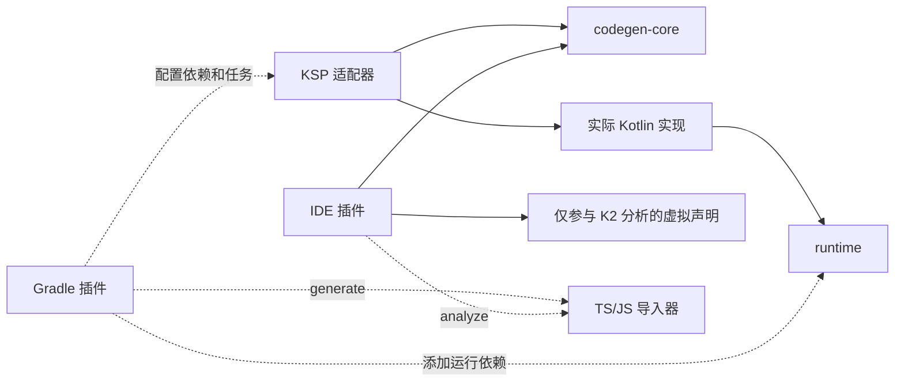

# IDE 解析与构建集成

这版先在一个 Git 仓库中建立模块边界，便于一起验证。IDE 插件和 Gradle 插件都有独立构建；以后拆仓库时，通过 Maven 产物和导入器分发包替换本地路径依赖。

## 每部分的职责

| 部分 | 职责 | 直接依赖 |
| --- | --- | --- |
| `kvue-runtime` | 运行时、注解、Vue 绑定，以及生成实现调用的公共 API | Kotlin/JS、Vue |
| `kvue-codegen-core` | 独立组件模型、参数命名、可选参数规则、Kotlin 实现和编辑期声明生成 | KotlinPoet |
| `kvue-ksp` | 读取 KSP 符号、解析别名和泛型继承、验证组件、写出实际源码 | KSP API、codegen-core |
| `tools/js-components` | 静态分析第三方 TS/JS，输出模型和 `@JsComponent` 接口 | Node.js、TypeScript |
| `kvue-gradle-plugin` | 为消费方配置依赖、源码目录和生成任务，并内置 JS 导入器 | Gradle API；消费方提供 Kotlin Gradle / KSP Gradle API |
| `kvue-idea` | 后台分析编辑器源码，发布 K2 虚拟声明，处理更新、导航和旧产物遮蔽 | IntelliJ/Kotlin K2 API、codegen-core；内置 JS 导入器 |
| 根项目 | 示例应用、浏览器测试、第三方组件接入示例 | runtime；通过 Gradle 插件配置 KSP |

`ComponentModel` 中没有 KSP 符号、PSI、KaType 或 Gradle Project。来源位置和符号生命周期由各自适配层管理。
IDE 与 KSP 调用同一个 `ComponentCodegen`；IDE 仅生成有明确类型的声明及不可执行的占位函数体。



## Gradle 插件做了什么

插件 ID 为 `org.kvue`，当前开发版本为 `0.1.0-SNAPSHOT`。应用显式启用 Kotlin Multiplatform 和官方 `com.google.devtools.ksp` 插件。
KVUE 插件不会替应用选择或应用这两个插件。

```kotlin
plugins {
    kotlin("multiplatform") version "2.4.21"
    id("com.google.devtools.ksp") version "2.3.12"
    id("org.kvue") version "0.1.0-SNAPSHOT"
}

kotlin { js { browser(); binaries.executable() } }

kvue {
    version.set("0.1.0-SNAPSHOT")
    // 默认目标是 js；可指定其他已声明的 Kotlin/JS 目标名称。
    targetName.set("js")
    // 存在 kvue.components.json 时自动使用；也可显式指定其他文件。
    componentsFile.set(layout.projectDirectory.file("kvue.components.json"))
}
```

配置完成后，插件：

1. 向目标 main source set 的 `api` 添加 `org.kvue:kvue-runtime`，供应用和公开生成 API 使用。
2. 向对应 `kspJs` / `kspJsTest` 配置添加 `org.kvue:kvue-ksp`。`processTests=false` 可关闭测试处理。
3. 有外部组件配置时，注册 `generateKvueJsComponents` / `generateKvueJsTestComponents`，并添加 TypeScript 开发依赖。
4. 根据 `exposeGeneratedSources`，将生成接口及 KVUE 实现加入 source set，或只接入 KSP / Kotlin 编译任务。
5. 连接 npm 准备、接口生成、KSP、必要的源码整理任务与 Kotlin 编译。KSP 任务仍由官方 KSP 插件创建和执行。
6. 声明配置文件、npm 源码/声明、已发现本地输入以及输出目录，支持 up-to-date 判断。报告包含绝对路径，目前未启用跨目录构建缓存。

```text
npm 准备 → generateKvueJsComponents → KSP → Kotlin/JS 编译 → 打包
应用中的 @VueComponent ────────────────↗
```

`addRuntimeDependency` / `addProcessorDependency` 可分别关闭自动依赖。
`runtimeProject` / `processorProject` 用于本仓库的 project 依赖；普通消费方使用默认 Maven 坐标。
`testComponentsFile` 可单独配置测试用第三方库。一个应用模块当前选择一个 JS 目标。

这些坐标是本地原型的发布坐标，尚未上传公共仓库。需要跨仓库试用时，可发布到本机 Maven：

```powershell
.\gradlew.bat :kvue-runtime:publishToMavenLocal :kvue-codegen-core:publishToMavenLocal :kvue-ksp:publishToMavenLocal
.\gradlew.bat -p kvue-gradle-plugin publishToMavenLocal
```

消费方分别在 `pluginManagement.repositories` 和普通 `repositories` 中添加 `mavenLocal()`。
插件包包含 JS 分析脚本，消费方无需复制本仓库的 `tools` 目录。

## 生成源的可见性开关

```kotlin
kvue {
    exposeGeneratedSources.set(false)
}
```

`true` 把生成源码暴露给 source set / IDE 模型；`false` 仍正常生成和编译，但 KVUE 的接口、DSL 实现仅作为构建任务输入，不加入 IDE 源目录。main 和启用处理的 test 都采用此设置。

优先级从高到低为：

1. Gradle 属性 `-Pkvue.exposeGeneratedSources=true|false`，也可写在 `gradle.properties`。
2. 显式 DSL 设置 `kvue.exposeGeneratedSources.set(...)`。
3. 用户环境变量 `KVUE_EXPOSE_GENERATED_SOURCES=true|false`。
4. IDEA 操作注入的默认环境变量 `KVUE_EXPOSE_GENERATED_SOURCES_DEFAULT=false`。
5. 内置默认 `true`。

仅接受 `true` / `false`（忽略大小写和两端空白）；非法值会报告配置错误。环境变量通过 Gradle Provider API 读取，切换值会使相关配置缓存失效，同一 Gradle daemon 也可以执行不同模式。

| 使用方式 | 默认行为 |
| --- | --- |
| 无 KVUE IDEA 插件 | 暴露生成源，先构建后获得生成 API 提示 |
| 有 KVUE IDEA 插件，通过 IDE 同步或构建 | 不暴露 KVUE 生成源，编辑器使用 K2 虚拟声明 |
| 显式设置 DSL / Gradle 属性 / 用户环境变量 | 按用户设置执行 |
| 外部终端执行 Gradle | 使用该终端环境；不会继承 IDEA 的操作级注入 |

例如，安装 IDEA 插件后仍可用 `kvue { exposeGeneratedSources.set(true) }` 强制暴露。临时构建可执行：

```powershell
.\gradlew.bat -Pkvue.exposeGeneratedSources=false check
```

改变开关或安装 / 禁用 IDEA 插件后，需重新同步 Gradle，使 IDEA 更新源目录模型。外部终端的构建不会改写 IDEA 已导入的模型。旧模型或显式打开开关时，插件继续通过 K2 shadowed scope 避免已接管声明的重复解析。

### KSP 输出隔离

官方 KSP 默认将多个处理器的 Kotlin 输出放在同一目录，因此不能直接隐藏整个 KSP 根目录。
KVUE Gradle 插件通过处理器参数，把自身生成文件放入该目录下的 `__kvue__/` 子树；未使用 KVUE Gradle 插件时，处理器仍使用标准输出布局。

关闭暴露时，`prepareKvueJsMainSources` / `prepareKvueJsTestSources` 在 KSP 完成后用 Gradle `Sync` 整理源码：

- `build/generated/kvue/build-only/<target>/<compilation>/kvue`：只供 Kotlin 编译任务使用。
- 同级 `other`：保留其他处理器输出，注册到 source set，IDE 仍能提示这些声明。
- 原始 `build/generated/ksp/.../kotlin`：保留 KSP 管理的文件、依赖关联和增量状态，不移动或删除；从该 compilation 的 IDE 源根中移除。
- 外部组件接口：只接入 KSP 输入和 Kotlin 编译输入，生成任务依赖保持完整。

整理任务按子树判断归属，不按文件名后缀猜测；其他处理器即使也生成 `*KVueGenerated.kt` 文件仍可见。直接运行 KSP 任务也会触发整理，更新 IDE 可见的其他产物。同步会清理已经删除的产物。整理目录排除在 KSP 输入外，避免把上一轮输出重新当作输入或造成任务依赖环。

这层集成验证了 Kotlin 2.4.21 / KSP 2.3.12 的普通 `kotlin` 目录注册和 `generatedKotlin` 目录注册两条路径。升级 Kotlin/KSP 后需要重跑插件集成测试；这里使用了 KGP 的实验性 `generatedKotlin` API。

## IDEA 原型

当前目标为 IntelliJ IDEA **2026.2.3 / 262** 的 Kotlin K2，插件开发构建使用 **JDK 25**。普通 KVUE 应用构建继续使用 JDK 21。

```powershell
# 在 JAVA_HOME 指向 JDK 25 后执行；ideaHome 指向本地安装，可省去下载 SDK。
.\gradlew.bat -p kvue-idea "-PideaHome=C:\path\to\IntelliJ IDEA" test buildPlugin
```

不传 `ideaHome` 时，独立构建会下载配置的 2026.2.3 SDK。
产物为 `kvue-idea/build/distributions/kvue-idea-0.1.0-SNAPSHOT.zip`，可通过 IDE 的 **Install Plugin from Disk** 安装。
先让 IDE 完成正常的 Gradle 同步，以识别运行库和 source set；随后新建、修改组件不需要先运行生成任务。

Gradle 集成为可选依赖：通过 `GradleExecutionHelperExtension.configureSettings`，在同步模型和执行任务两条路径注入 `KVUE_EXPOSE_GENERATED_SOURCES_DEFAULT=false`。只修改当前操作的设置副本，交给 IDEA 合并父进程环境；保留已有环境变量、`PATH`、`JAVA_HOME` 和父环境继承选项，不修改系统环境或运行配置。显式配置的同名默认变量也会保留。

插件使用 `KaResolveExtensionProvider` / `KaResolveExtensionFile`，并遵守回调内不能调用 Kotlin 语义解析的要求：

1. 在后台 smart read action 中扫描当前 PSI，用 K2 解析注解、委托属性类型、类型别名及已具体化的继承类型。
2. 将类型转换为独立模型，缓存模型、来源指针和生成声明。缓存不保留 KaSymbol / KaType。
3. Resolve Extension 回调只读取快照，供正常解析、补全及自动导入使用。
4. 编辑后的 PSI 提交会合并触发刷新；替换虚拟文件前后发布模块状态与 out-of-block 失效事件，使 K2 的文件作用域、参数信息和解析结果一起刷新。
5. `getShadowedScope()` 只遮蔽已接管组件对应的 KVUE 生成文件。文件仍留在磁盘，正常构建输入不变。

参考 [Kotlin Resolve Extension 接口](https://github.com/JetBrains/kotlin/blob/master/analysis/analysis-api/src/org/jetbrains/kotlin/analysis/api/resolve/extensions/KaResolveExtension.kt) 和 [Provider 回调约束](https://github.com/JetBrains/kotlin/blob/master/analysis/analysis-api/src/org/jetbrains/kotlin/analysis/api/resolve/extensions/KaResolveExtensionProvider.kt)。

默认从项目根目录的 `kvue.components.json` 分析第三方组件，将虚拟声明关联到 `src/main/kotlin` 或 `src/jsMain/kotlin` 所属模块。
已有 npm 依赖是分析外部库的前提；插件不会执行依赖安装、Gradle 或 KSP。
分析使用系统 PATH 中的 `node` 和本地 `build/js/node_modules` / `node_modules`，项目须处于 IDE 的 trusted 状态。

多 source set 或自定义路径通过根目录的 `kvue.ide.json` 指定；这些是编辑器配置，不是构建输入：

```json
{
  "nodeExecutable": "node",
  "nodeModules": "build/js/node_modules",
  "imports": [
    { "configuration": "kvue.components.json", "sourceRoots": ["src/main/kotlin"] },
    { "configuration": "tools/js-components/fixtures/components.json", "sourceRoots": ["src/test/kotlin"] }
  ]
}
```

每组 `sourceRoots` 应明确对应一个已导入的 Kotlin source module，且至少有一个 Kotlin 文件作为模块定位依据。
路径相对于项目根目录。未配置的选项使用默认值。
第三方声明更新、配置更新及项目根变化会触发后台分析；普通 Kotlin 编辑复用外部分析缓存。
Kotlin 与外部库各有独立刷新队列，Node 缺失或外部分析失败不会阻塞原生组件声明。
`Tools → KVUE` 提供手动刷新和查看诊断。未知或尚未解析出的类型会记录诊断，而不是生成猜测的精确签名。

只读分析入口也可单独调用：

```powershell
node tools/js-components/generate.cjs --analyze --config kvue.components.json --node-modules build/js/node_modules
```

它只向 stdout 输出模型和 schema JSON；IDE 将脚本解包到自身缓存目录，不向项目写入源码。

## 验证与当前范围

- `gradlew check jsBrowserDistribution`：根应用通过 Gradle 插件构建、KSP 及共享规则测试、TS/JS 分析测试、Vue 浏览器行为和生产打包；两种生成源可见性模式均可运行。
- `gradlew -p kvue-gradle-plugin test validatePlugins`：测试将插件发布到 `build/test-repository`，由独立消费项目加载，检查依赖、源码目录、任务顺序和缺失插件提示；还验证配置优先级、同一 daemon 的环境变化、配置缓存复用、两种 KSP 源目录 API、其他生成器及处理器的接线、切换模式和删除产物。
- `gradlew -p kvue-idea ... test buildPlugin verifyPluginStructure`：真实 IntelliJ/K2 测试框架检查跨包解析、补全导入、参数更新、删除组件、旧产物遮蔽、继承/别名、Kotlin/JS 模块和外部模型的虚拟声明；通过 SDK 的 `GradleExecutionHelper.prepareForExecution`，验证模型导入 / 执行任务均注入默认值且保留已有环境。

本地 IU 262.10968.63 的测试 classpath 中，一个混淆过的 Ultimate 启动扩展被解析成接口；测试启动时只隔离这个无关扩展。
Kotlin 解析器、Resolve Extension、补全和高亮均使用真实 SDK；插件发行包不包含此测试适配。

原型依赖实验性的 K2 SPI，兼容范围暂限定 262，尚未覆盖其他 IDE 版本或 Android Studio。
源码索引暂按项目合并扫描，尚未做细粒度的组件依赖图；大型项目需进一步测量编辑延迟。
外部库复杂类型和动态 JS 的边界沿用 [TS/JS 导入说明](vue-js-components.md)。
IDE 声明不进入 Gradle source set，也不替代 KSP 的构建验证；未安装插件时，应用构建链路仍然完整。
