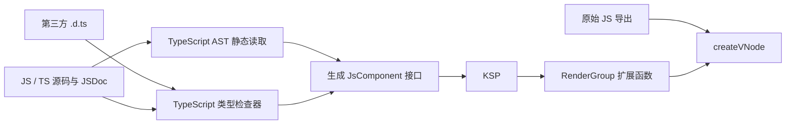

# Vue 的组件对象与第三方组件导入

本文对应项目使用的 Vue 3.5.44。
构建任务已封装到 `kvue-gradle-plugin`；编辑期解析使用可选的 `kvue-idea`。详见 [模块与插件接入](ide-and-build.md)。

## Vue 如何决定一个值是组件

Vue 根据传给 `createVNode(type, props, children)` 的 `type` 选择处理路径。对于普通类型：

| `type` 的形态 | Vue 的处理方式 |
| --- | --- |
| 字符串，如 `"div"` | HTML/原生元素 |
| 非 `null` 对象 | 有状态组件定义 |
| 函数 | 函数式组件 |

内置节点和兼容适配还有专门分支。普通组件对象无需继承某个 JS class，也不需要统一的隐藏标记。
`__v_isVNode` 标记的是已创建的 VNode，不能用它识别组件定义。
普通更新中，Vue 比较节点的 `type` 引用和 `key`；因此应复用组件定义，按每次渲染创建新 VNode。
参见 [Vue 的节点分类与身份判断](https://github.com/vuejs/core/blob/v3.5.44/packages/runtime-core/src/vnode.ts)。

`defineComponent(optionsObject)` 在运行时返回原对象，主要作用是为 TypeScript 提供类型推断。
但 `defineComponent(setupFunction)` 会把函数放入一个对象的 `setup` 字段。
所以导入第三方函数式组件时，不能随意再次套用 `defineComponent`，否则会改变它的执行含义。
参见 [defineComponent 实现](https://github.com/vuejs/core/blob/v3.5.44/packages/runtime-core/src/apiDefineComponent.ts)。

“按组件处理”不代表“对象一定能正确渲染”。Vue 随后创建实例、初始化 props/slots、调用 `setup`，并确定渲染函数：
可以来自 `setup` 返回值、`render` 选项，或支持运行时编译时的 `template`。
空对象也会进入组件路径，但最终会收到缺少模板或渲染函数的提示。
参见 [组件实例初始化与渲染准备](https://github.com/vuejs/core/blob/v3.5.44/packages/runtime-core/src/component.ts)。

这也意味着：整个模块命名空间、带 `install()` 的插件对象、工具函数，不能仅凭 `typeof` 就自动认作库里的 UI 组件。

## KVUE 的导入链路



`tools/js-components/generate.cjs` 使用 TypeScript Compiler API，统一解析声明文件、JS 和 TS 源码；`source-analysis.cjs` 负责读取 Vue 的源码结构。
分析过程不执行组件库入口、工厂函数或 getter。运行时仍导入原始组件。
使用的是 TypeScript 6.0.3 的 JS API；TypeScript 7 的编译器 API 已改变，不能直接替换这个工具依赖。
参见 [TypeScript Compiler API 文档](https://github.com/microsoft/TypeScript/wiki/Using-the-Compiler-API)。

自动发现支持以下声明形态：

- Vue 组件构造类型：从实例类型的 `$props` 和 `$emit` 提取公开调用接口。
- `FunctionalComponent` 一类可调用声明：读取 props 和事件声明。
- 明确带渲染函数、模板或返回渲染函数的 `setup` 的 options 对象：读取其 props/emits 声明。

Vue 的 `DefineComponent` 类型中的 `new()` 签名用于描述组件公共实例，不表示运行时导出值必须是 JS class。
生成器通过这个类型取得 `$props`/`$emit`，不会对第三方导出执行 `new`。

这是声明层面的结构识别，无法替代组件库本身的正确性。对无法自动判定的导出，可以在配置里显式选择；缺失或不支持的导出会报错。

## 为什么继续使用 TypeScript AST

TypeScript 的解析器也支持 JavaScript；启用 `allowJs` 后，同一个 Program 可以解析 `.js`、`.mjs`、`.cjs` 和 TS 文件，并用类型检查器读取 JSDoc、模块导出和导入别名。
因此不需要为了 JS 再安装一套 AST 解析器。参见 [allowJs](https://www.typescriptlang.org/tsconfig/allowJs.html) 和 [JavaScript 类型推断与 JSDoc](https://www.typescriptlang.org/docs/handbook/type-checking-javascript-files.html)。

AST 和类型检查器承担不同工作：

| 信息 | 读取方式 |
| --- | --- |
| `.d.ts` 的公开 props、事件重载、复杂类型 | TypeScript 类型检查器 |
| JS 中的 JSDoc 参数、函数类型 | 同一个类型检查器 |
| `props: ['title']`、`emits: ['change']` | AST 保留字符串字面量，避免退化为 `string[]` |
| `required: true` | AST 保留布尔字面量，避免导入常量的类型被拓宽为 `boolean` |
| `defineComponent({...})`、导出别名、常量、对象展开 | 静态追踪对应的 AST 节点 |

目前能读取 Vue 的 `defineComponent`（包括别名、命名空间、CommonJS 引入及 setup 函数重载）、直接 options 对象，以及通过顶层 `Component.props` / `Component.emits` 声明元数据的函数式组件。
支持 props 的数组/对象形式、构造器数组、静态属性名、常量导入和展开；emits 支持字符串数组、validator 对象及 `null` validator。

例如以下纯 JS 不需要额外 `.d.ts`：

```javascript
import { defineComponent, h } from 'vue';

export const Rating = defineComponent({
  props: { value: { type: Number, required: true } },
  emits: {
    /** @param {number} value */
    change: value => typeof value === 'number',
  },
  setup(props, { emit }) {
    return () => h('button', { onClick: () => emit('change', props.value + 1) }, props.value);
  },
});
```

它会生成可调用的 `Rating(value = 1.0, onChange = { value -> ... })`。
如果只有 `emits: ['change']`，源码没有描述 payload 类型，生成的 `onChange` 接收 `Array<Any?>`，保留所有 JS 实参。
生成器不会仅凭组件内部某一次 `emit(...)` 调用，断言整个公开事件协议只有那一种参数形式。

Babel parser 的优势是更多 JS 语法扩展（如 Flow、实验性语法），但 AST 本身不能代替这里需要的 TypeScript 类型解析。
目前没有遇到必须增加它的输入；遇到这类语法时再增加前端解析适配。参见 [Babel parser 支持范围](https://babeljs.io/docs/babel-parser)。

KSP 为每个导入接口生成：

1. `@JsModule` 导入声明，选择真实的 named/default/CommonJS 导出。
2. `XxxVue.definition`，仅保存原始 JS 组件引用。
3. `RenderGroup.Xxx(...)`，将参数转为 Vue props、事件监听器和 slots。

外部组件不创建 KVUE 的 `Component` 实例，不覆盖原组件的 `props`、`emits`、`setup` 或生命周期。
未提供的参数不会写入 VNode，原组件的默认值和 Boolean prop 行为继续由 Vue 执行。

## 接入一个 npm 组件库

先在 `jsMain.dependencies` 中声明依赖，例如：

```kotlin
implementation(npm("element-plus", "2.14.7"))
```

然后编辑 `kvue.components.json`：

```json
{
  "libraries": [
    {
      "module": "element-plus",
      "package": "kvue.js.elementplus",
      "exports": "*"
    }
  ]
}
```

`exports` 可以是：

- `"*"`：自动发现所有支持的组件导出。
- `["ElButton", "ElInput"]`：只生成选定组件。
- `{ "default": "DatePicker" }`：为默认导出指定 Kotlin 名称。
- `{ "export=": "CommonJsWidget" }`：选择 TypeScript 的 CommonJS `export =` 声明。

如果声明文件不在 npm 包的默认入口，可增加 `declarations`，相对于配置文件指定 `.d.ts` 路径。
它只改变类型分析入口，运行时仍从 `module` 导入组件。

默认遵循 TypeScript 的模块解析：优先使用包的类型声明，没有声明时通过 `allowJs` 读取 JS 入口。
需要直接分析源码时，改用 `source`，路径同样相对于配置文件：

```json
{
  "libraries": [
    {
      "module": "some-vue-library",
      "source": "./node_modules/some-vue-library/dist/index.mjs",
      "package": "kvue.js.widgets",
      "exports": "*"
    }
  ]
}
```

本项目由 Gradle 安装的 npm 包位于 `build/js/node_modules`，使用此布局时将示例路径改成 `./build/js/node_modules/...`。
`source` 可指向 JS 或 TS 源码，`declarations` 与 `source` 互斥。目前选择一个分析入口，不自动合并两者有冲突的接口。
指定 `source` 只改变分析来源，生成的 `@JsModule` 仍使用 `module`。

在消费应用目录中运行，例如已按 README 准备好本地依赖的 `examples/element-plus-demo`：

```powershell
.\gradlew.bat generateKvueJsComponents
.\gradlew.bat jsBrowserDistribution
```

导入器自身的测试位于 `tools/js-components`，从仓库根目录运行 `:js-component-importer:check`。
该模块的 `generateKvueJsTestComponents` 只生成本模块的测试声明，JS/TS 夹具位于 `fixtures`。

正常 Kotlin 编译也会自动执行生成任务。输出均在 `build` 下，不需要提交：

- `build/generated/kvue/js-components/kotlin`：从声明或源码生成的接口。
- `build/generated/ksp/js/jsMain/kotlin`：KSP 生成的导入声明、定义和 DSL。
- `build/generated/kvue/js-components/report.json`：组件、参数、类型转换说明、跳过导出，以及 `declarations` / `sources` 文件清单。组件的 `analysis` / `source` 字段记录分析来源；源码结构诊断包含文件和行号。

每个组件还包含可选的 `navigation`（实际导出声明的文件、UTF-16 行列、长度和文本）及 `moduleSource`（可静态解析到的 JS 模块入口）。
IDE 用这些信息把虚拟 Kotlin 调用直接导航到 `.d.ts` 或 JS；跟随转导出使用 TypeScript 符号，不执行组件库代码。
元数据是 schemaVersion 2 的兼容扩展，旧报告缺少坐标时仍可打开来源文件。

修改组件选择后，导入器会删除自己先前生成、当前已不需要的接口，防止遗留旧绑定。
Gradle 会跟踪生成器、npm 中的源码/声明、显式入口及报告中发现的本地导入源码，源码修改会触发重新生成。

## 调用生成的 DSL

例如在组件的 `body` 中使用生成的 Element Plus 接口：

```kotlin
import kvue.js.elementplus.ElButton
import kvue.js.elementplus.ElInput
import kvue.provided
import kvui.text

// text 是当前组件的 ref 属性。
override val body = RenderFun {
    ElButton(type = "primary", onClick = { println("clicked") }) {
        text("保存")
    }
    ElInput(
        modelValue = provided(text),
        onUpdateModelValue = { text = it },
    )
}
```

Element Plus 的 `modelValue` 可以为 `null`，所以使用 `provided(text)` 区分“提供值”和“未提供”。
组件尾随块中的普通内容是默认插槽，也可直接声明 `slot("header") { ... }`。导入器读取到 TypeScript 的 `$slots` 名称时，会生成 `slots.header { ... }` 等专属成员；函数组件及声明生成器附加的构造签名也参与名称读取。原有返回节点上的 `.slot("header") { ... }` 继续支持链式使用。声明位置和延迟执行规则见 [插槽说明](slots.md)。

某些组件也有名为 `content` 的 prop。导入器会将该参数改名为 `contentProp`，并保留实际 JS 属性名 `content`，为默认 slot 的 `content` 参数留出位置。

库要求的样式和全局初始化仍应按库文档配置。组件导入不会自动执行 `app.use(...)` 或加载 CSS。
例如 Element Plus 的全局样式入口为 `element-plus/dist/index.css`；服务函数、安装插件不会被包装为渲染组件。
参见 [Element Plus 官方接入说明](https://element-plus.org/en-US/guide/quickstart.html)。

## 类型转换边界

导入器同时生成专属节点、链式事件和公开实例 facade：

```kotlin
private val input = ElInputVue.ref()

// RenderGroup 内
ElInput(vModel = text).ref(input).onChange { value, event -> /* ... */ }
ElButton { text("聚焦") }.onClick { input.value?.focus() }
```

事件参数以当前库声明为准。实例方法优先读取 TS 公开实例类型；源码入口支持静态 `setupContext.expose({...})`、
解构/重命名后的 expose、setup 返回的对象和 Options API 的 methods / expose 白名单。
不执行组件源码；条件式、重复或无法解析的 expose 会记录诊断，不生成猜测的公开成员。
源码 data/computed 和任意闭包数据流尚未展开，需要声明文件补全。

可选方法参数使用 `OptionalProp<T>`：不传保持 JS 默认值，`provided(null)` 显式传 null，`provided(value)` 传具体值。
rest、重载或泛型方法会以参数数组提供入口，并记录类型放宽；调用保留 JS 的 `this`。
从第三方声明导入的属性目前只读，原生 Kotlin `@Expose var` 则生成可写访问器。
facade 的 `asDynamic()` 用于未建模的公开接口。函数式组件没有组件实例，因此不生成实例 ref。

所有接口由共享生成器提供给 KSP 和 IDEA，链式方法及实例方法在首次构建前也有补全、类型检查和导航。

| TypeScript 声明 | 生成的 Kotlin 形态 |
| --- | --- |
| `string`、同类字符串字面量联合 | `String`，原始联合保留在 KDoc/报告中 |
| `number` | `Double` |
| `boolean` | `Boolean` |
| 数组 | `Array<T>` |
| 普通函数 | Kotlin 函数类型 |
| 部分 DOM 事件类型 | `org.w3c.dom.events` 类型 |
| 可选、非空 prop | 可空参数，`null` 表示省略 |
| 可选且允许 `null` 的 prop | `OptionalProp<T?>`，通过 `provided(null)` 显式传空值 |
| rest 事件或 rest callback prop | 以 `Array<Any?>` 接收全部 JS 参数，生成适配函数 |
| 异类联合、结构对象、无法准确表达的复杂类型 | `Any`/`Any?`，并记录转换说明 |

类型放宽不会偷偷转成一个虚假的精确类型。使用复杂对象时应传 JS 原生对象或数组，例如通过 `jso(...)` 构建对象；不会自动把 Kotlin `Map`/`List` 序列化成第三方库的数据结构。

当前不自动生成字符串字面量枚举、任意 TypeScript 结构类型的 Kotlin wrapper、类型化作用域插槽，或组件库的普通服务 API。

源码分析有额外边界：

- 支持声明式初始化和可静态追踪的常量，不模拟任意 JS 执行。自定义工厂、运行时条件、函数调用产生的 props、getter 等无法可靠还原时会报告；可以给这些组件提供 `.d.ts`。
- 未知对象展开可能覆盖先前属性，因此会放弃此前不能保证的键；后面明确写出的键仍保留。未知构造器数组会放宽为 `Any?`。
- 对直接赋值等可检测的元数据修改采取保守处理；不做完整的数据流、别名逃逸或跨调用副作用分析，不能保证还原任意打包产物的最终运行状态。
- `mixins` / `extends` 的源码继承暂不展开，会提示需要声明补全继承接口；`.vue` SFC、Flow 及自定义打包 helper 暂无专用解析器。
- JSDoc 与 `.d.ts` 都是类型描述，不等于运行时验证。信息不足时保留 `Any`/`Any?` 或参数数组，并查看报告中可能缺失的字段。

## 验证

`check` 会执行声明/源码分析器测试以及浏览器测试，覆盖：

- named/default/CommonJS 导出和函数式组件。
- 原始组件引用身份、独立状态、JS 默认值、显式 `null`、props 更新。
- 普通、多参数、rest 事件及 rest callback prop。
- 默认和具名插槽。
- 真实 Element Plus 按钮点击、禁用状态和输入框模型更新。
- 无 `.d.ts` 的 ESM/CommonJS 组件、JSDoc 事件、源码 props/emits 数组、Boolean prop 默认值与更新。
- npm 的 JS 回退、声明优先级、显式源码入口、展开顺序、动态元数据与循环引用。分析测试文件包含顶层 `throw`，确保分析不会执行组件源码。

原有 KVUE class 组件测试继续保留，确保自动 JS 导入不会破坏已有 DSL。
